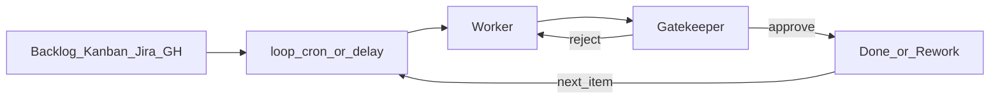

# Session loops (loop)

> `@skill:loop` returns the agent to **this chat** at a **set time**.  
> Combine that with a **writer** and a **reviewer** so the agent works through a task list without asking you at every step.

---

## Why use it

Long-running automation aims for two results:

1. **Fewer prompts from you** — you do not start every ticket by hand.
2. **Better quality without one-sided judgment** — the person who builds is not the only one who passes the work.

`loop` is the **clock**. When a delay or a daily time fires, LibrAgent injects an instruction into the same session. Chat history, workspace, and context stay with that chat.

Fewer prompts is not “set and forget”:

- Write pass rules first.
- Cap rework (usually three rounds).
- If the cap is hit or the queue is empty, send you a short report.

---

## Pattern: writer and reviewer

Keep the two roles apart so review stays honest.

| Role                        | Job                                                                   |
| --------------------------- | --------------------------------------------------------------------- |
| **Writer (Worker)**         | Take **one** item from the list and build or draft it.                |
| **Reviewer (Gatekeeper)**   | Check the list of rules. Say **pass** or **reject** with clear fixes. |
| **This chat (coordinator)** | Wake on `loop` and run **one** writer↔reviewer cycle.                |



A good cycle:

1. Pick **one** item (or a very small batch).
2. The writer produces the result.
3. The reviewer checks the checklist.
4. On pass, mark the ticket done. On reject, send fixes back to the writer.
5. If rework hits the limit, summarize what is left for you.
6. Wait for the next wake.

For the review skill itself, see [`gatekeeper`](sub-agents.md).

---

## Which skill should you use?

Do not mix clock, completion, and app-wide schedule.

| What you want                                           | Skill          | Example                                           |
| ------------------------------------------------------- | -------------- | ------------------------------------------------- |
| Return to **this chat** on a **clock** to work the list | `loop`         | “Every 30 minutes, process one ready issue.”      |
| Resume when a job or ticket is **done**                 | `call-me-back` | “When this issue closes, write the release note.” |
| Run on an **app-wide** cron even if this chat closes    | `schedule`     | “Every Monday at 9, run the briefing assistant.”  |
| Writer ↔ reviewer quality gate                         | `gatekeeper`   | “Draft the notice and pass these three rules.”    |

Kanban, Jira, and GitHub Issues are **task lists**.  
Do not fake “wait until Done” with a `loop` delay. Use [`call-me-back`](call-me-back.md) when something finishes.

For app-wide schedules, see [Automation overview](automation.md) and [Scheduled Tasks](scheduled-tasks.md).

---

## How to use this in LibrAgent

### 1. Start a loop in this chat

Ask in an open session. The agent uses `scheduleCallback` (skill name `loop`).

```text
@skill:loop
Every 30 minutes, run exactly one cycle in this chat:
- task list: …
- one item per cycle
- writer / reviewer roles and pass rules: …
- max 3 rework rounds; if blocked, summarize for me
```

Or a daily time:

```text
@skill:loop
Every day at 09:00, return to this chat and process one GitHub ready issue with writer then reviewer.
```

### 2. What to put in the wake message

The agent may not remember every earlier detail. Write an instruction that works **on its own**:

- Where the list lives (board, project, labels)
- How to pick an item (for example, oldest `ready` issue)
- Writer / reviewer roles and paths they must not touch
- Pass checklist (`- [ ] …`)
- Rework limit and how to mark Done
- How to report blockers to you

### 3. Manage the loop

- Pause or delete it in the session **Planning** panel.
- Deleting the session removes its loops.
- If the job must keep running when this chat is gone, move it to global `schedule`.

### 4. Tools and permissions

For Jira or GitHub, install MCP presets in [Extensions](extensions.md) and allow them on the Assistant’s Tools tab.

---

## Practical examples

Copy a prompt and change the repo, labels, and rules.

### GitHub Issues

```text
@skill:loop @skill:gatekeeper
Every hour on the hour, run one cycle in this chat.

Rules:
1) In OWNER/REPO, take the oldest open issue with label=ready.
2) The writer makes the minimum change (or a draft reply). Touch no other issues.
3) The reviewer checks:
   - [ ] Acceptance criteria are met
   - [ ] Verification evidence is recorded
   - [ ] No files outside the issue scope were changed
4) On pass, leave a short comment and remove ready or close the issue.
5) On reject, send a clear fix list to the writer; same issue, max 3 rework rounds.
6) If it still fails or the queue is empty, report one short paragraph to me.
```

### Jira / kanban board

```text
@skill:loop @skill:gatekeeper
Every 2 hours, run one cycle on board "Team backlog".

Rules:
1) Move the highest-priority card in "To Do" to "In Progress".
2) The writer builds the result against the card’s Definition of Done.
3) The reviewer checks that checklist.
4) On pass, move to "Done" and leave a work log. On reject, keep In Progress with feedback.
5) Max 3 rework rounds. If blocked, summarize for me.
```

To wait until a card is **Done**, then write release notes, use `call-me-back` on that card — not a guessed delay.

### Org board + role split

For a lasting team, set writer/reviewer roles with [teamwork → org](sub-agents.md), then put `loop` on the **lead** chat.

```text
@skill:teamwork @skill:org @skill:loop @skill:gatekeeper
Use the Org team’s KANBAN.md as the task list.
Every day at 10:00 in the lead chat:
- Give one To Do to the writer
- The reviewer passes or rejects using ROLES.md quality rules
- Run one cycle only and update KANBAN
```

Short prompts also live in [Orchestration examples](orchestration-examples.md).

---

## What to avoid

| Avoid                                           | Why                        | Do this instead                       |
| ----------------------------------------------- | -------------------------- | ------------------------------------- |
| “Check again in 5 minutes; it is probably done” | Guesses completion         | `call-me-back`                        |
| Pass rule is only “looks good”                  | Rework never ends          | Concrete checklist                    |
| Clear the whole list in one wake                | The chat grows too large   | One item (or a small batch) per cycle |
| Writer declares final pass alone                | Review has no force        | Only the reviewer declares pass       |
| Need app-wide uptime but only use `loop`        | Loops die with the session | Global `schedule`                     |

---

## Related guides

- [Continue when done (call-me-back)](call-me-back.md) — wake when something finishes
- [Automation overview](automation.md) · [Scheduled Tasks](scheduled-tasks.md) — app-wide schedule
- [Sub-agents & orchestration](sub-agents.md) — `gatekeeper`, Org
- [Orchestration examples](orchestration-examples.md) — short prompts
- [Skills](skills.md) — bundled skill list
