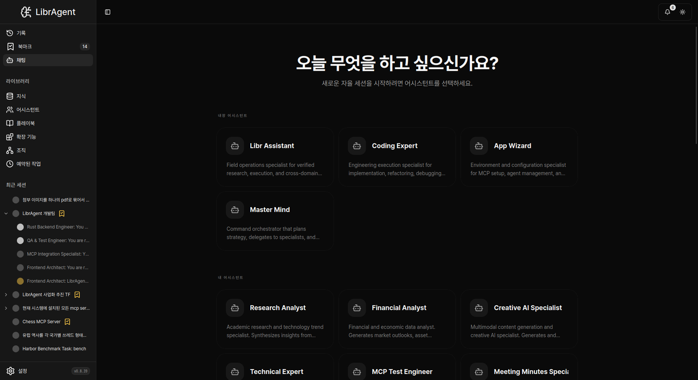
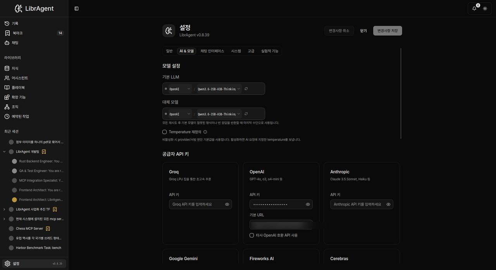

# 5분 시작 가이드

> LibrAgent를 설치하고 첫 에이전트 대화까지. **개발 환경 설정 불필요** — 데스크톱 앱을 다운로드하면 됩니다.

---

## 이 가이드에서 배우는 것

1. LibrAgent 실행
2. Settings에서 API 키·기본 모델 설정
3. **Chat**에서 어시스턴트를 골라 세션 시작
4. **App Wizard**로 PC 환경(Python·Node 등) 준비하기

**소요 시간**: 약 5분  
**필요**: LibrAgent 앱, 인터넷, 공급자(API) 키

---

## 1단계: LibrAgent 실행

[GitHub Releases](https://github.com/fritzprix/libr-agent/releases)에서 OS에 맞는 설치 파일을 받아 설치한 뒤 앱을 실행합니다.

왼쪽 **사이드바**에 **Chat**, **Settings** 등 메뉴가 보입니다. (설정은 우측 상단 버튼이 아니라 **사이드바 → Settings**입니다.)



---

## 2단계: 모델 연결 (API 키)

에이전트와 대화하려면 API 키가 필요합니다. 자세한 필드는 [모델 연결하기](connecting-models.md)를 참고하세요.

1. 사이드바에서 **Settings**를 엽니다.
2. 탭 **AI & Models**를 선택합니다.
3. **Provider API Keys**에서 사용할 공급자(Anthropic, OpenAI, Google Gemini 등) 카드를 찾습니다.
4. **API Key**에 키를 붙여넣고 **Save Changes**를 누릅니다.
5. 같은 탭의 **Model Preferences**에서 **Default LLM**을 고를 수 있습니다.



> UI에 **「LLM Provider」**라는 메뉴/섹션 이름은 없습니다. 키는 **Provider API Keys**, 기본 모델은 **Default LLM**입니다.

---

## 3단계: 첫 세션 시작

1. 사이드바에서 **Chat**을 엽니다.
2. **Built-in Assistants**에서 어시스턴트 카드를 클릭합니다. (예: **Libr Assistant**, **Coding Expert**, **App Wizard**)
3. 초안 화면 제목은 **New Session**입니다. 입력창에 메시지를 쓰고 보냅니다.

```
안녕! 너는 뭐가 뭐야? 간략히 소개해줘.
```

에이전트는 생각하기 → (필요 시) 도구 호출 → 최종 응답 순으로 답합니다.

> **「+ New Session」** 같은 전용 버튼으로 시작하는 흐름이 아닙니다. **Chat → 어시스턴트 선택**이 새 세션의 시작입니다.

---

## 4단계: App Wizard로 환경 준비하기

별도 “설치 마법사 창”은 없습니다. **Chat**의 **App Wizard** 어시스턴트에게 말하면 됩니다.

**Chat → Built-in Assistants → App Wizard**

예:

```
Python이랑 Node가 이 PC에 깔려 있는지 확인해 주고, 없으면 설치 방법 알려줘.
```

코딩·터미널·확장(MCP)을 쓰기 전에 **한 번 App Wizard와 대화**해 두면 이후가 수월합니다.  
같은 주제를 `@skill:setup-wizard`로 불러올 수도 있습니다. → [스킬 가이드](../guides/skills.md)

---

## 완료!

| 다음          | 문서                                      |
| ------------- | ----------------------------------------- |
| Settings 세부 | [모델 연결하기](connecting-models.md)     |
| Chat·세션 UI  | [에이전트 첫 대화](first-agent.md)        |
| 증상별 해결   | [문제 해결](../guides/troubleshooting.md) |

---

_사용자용 가이드입니다. 개발자 환경 구축은 [getting-started.md](https://github.com/fritzprix/libr-agent/blob/main/docs/guides/getting-started.md)를 참고하세요._
