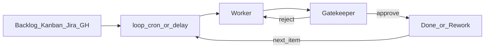

# 세션 루프 (loop)

> `@skill:loop`은 **정해진 시각**에 **이 대화**로 돌아와 일을 이어 가게 합니다.  
> 할 일을 조금씩 처리하고, **작성자**가 만들고 **검수자**가 심사하는 구조와 함께 쓰면 매번 “다음 해 줘”를 누르지 않아도 됩니다.

---

## 왜 쓰나요

오래 가는 자동화에서 바라는 점은 두 가지입니다.

1. **개입을 줄입니다** — 티켓마다 직접 지시하지 않습니다.
2. **품질을 스스로 올립니다** — 만든 사람이 혼자 합격을 정하지 않게 역할을 나눕니다.

`loop`는 그 중 **시계**입니다. 지연 시간이나 매일 같은 시각이 되면 같은 대화에 지시가 들어가고, 에이전트가 다시 일합니다. 대화 내용·작업 폴더·기록은 그대로입니다.

개입을 줄인다고 해서 **손 놓는 것**은 아닙니다.

- 합격 기준을 먼저 적습니다.
- 다시 고치는 횟수에 한도를 둡니다 (보통 3번).
- 한도에 닿거나 할 일이 없으면 짧게 알려 줍니다.

---

## 패턴: 작성자와 검수자

서로 다른 눈으로 검증하려면 역할을 나눕니다.

| 역할                    | 하는 일                                                            |
| ----------------------- | ------------------------------------------------------------------ |
| **작성자 (Worker)**     | 할 일 목록에서 **한 건**을 가져와 구현하거나 초안을 씁니다.        |
| **검수자 (Gatekeeper)** | 기준에 맞는지 봅니다. **통과** 또는 **반려(고칠 점)** 만 말합니다. |
| **이 대화 (조율)**      | `loop`로 주기적으로 깨어, 작성↔검수 **한 바퀴**만 돌립니다.       |



한 바퀴 권장 순서:

1. 할 일에서 **1건**만 고릅니다 (많아야 소수).
2. 작성자가 결과물을 냅니다.
3. 검수자가 체크리스트로 심사합니다.
4. 통과하면 티켓을 완료로 옮기고, 반려하면 고칠 점과 함께 다시 고칩니다.
5. 다시 고치기 한도에 닿으면 남은 문제를 짧게 알립니다.
6. 다음 깨울 때까지 쉽니다.

검수 스킬 자체는 [`gatekeeper`](sub-agents.md)를 보세요.

---

## 어떤 스킬을 쓰나요?

시계·완료 신호·전역 일정을 섞지 마세요.

| 하고 싶은 일                                  | 스킬           | 예시                                             |
| --------------------------------------------- | -------------- | ------------------------------------------------ |
| **정해진 시각**에 이 대화로 돌아와 할 일 처리 | `loop`         | “30분마다 ready 이슈 1건 처리해 줘.”             |
| 빌드·티켓 **완료**·웹훅이 **끝나면** 깨우기   | `call-me-back` | “이 이슈가 닫히면 배포 노트를 써 줘.”            |
| 채팅을 닫아도 도는 **앱 전체** 일정           | `schedule`     | “매일 9시에 브리핑 어시스턴트를 돌려 줘.”        |
| 작성 ↔ 검수 품질 확인                        | `gatekeeper`   | “초안을 쓰고 세 가지 기준을 통과할 때까지 돌려.” |

칸반·Jira·GitHub Issues는 **할 일 목록**입니다.  
“티켓이 끝날 때까지 기다리기”를 `loop` 지연으로 짐작하지 마세요. 끝났다는 신호는 [`call-me-back`](call-me-back.md)입니다.

앱 전체 예약은 [자동화 개요](automation.md)·[예약 작업](scheduled-tasks.md)을 보세요.

---

## LibrAgent에서 쓰는 법

### 1. 이 대화에 루프 걸기

열려 있는 채팅에서 요청합니다. 에이전트는 `scheduleCallback`(스킬 이름 `loop`)을 씁니다.

```text
@skill:loop
앞으로 30분마다 이 대화에서 아래 규칙으로 한 바퀴만 돌려 줘.
- 할 일 목록: …
- 한 바퀴에 1건만
- 작성자 / 검수자 역할과 합격 기준: …
- 다시 고치기 최대 3회, 막히면 나에게 요약
```

매일 같은 시각이면:

```text
@skill:loop
매일 오전 9시에 이 대화로 돌아와 GitHub ready 이슈 1건을 작성→검수로 처리해 줘.
```

### 2. 깨울 때 넣을 말

다시 깨어난 에이전트는 예전 대화를 다 기억하지 못할 수 있습니다. 주입 문장은 **그 문장만 보고도** 일하게 적으세요.

- 할 일 출처 (보드·프로젝트·라벨)
- 고르는 규칙 (예: `ready` 중 가장 오래된 1건)
- 작성자 / 검수자 역할과 건드리면 안 되는 범위
- 합격 체크리스트 (`- [ ] …`)
- 다시 고치기 한도, 완료 시 상태 바꾸는 방법
- 막혔을 때 나에게 알리는 형식

### 3. 관리

- 세션 **Planning**에서 잠시 끄거나 지울 수 있습니다.
- 세션을 지우면 그 세션의 루프도 사라집니다.
- 채팅과 관계없이 **앱 전체**에서 계속 돌려야 하면 `schedule`(예약 작업)로 올립니다.

### 4. 도구·권한

Jira·GitHub 등을 쓰려면 먼저 [Extensions](extensions.md)에서 MCP를 설치하고, 그 Assistant의 Tools에서 허용하세요.

---

## 실전 사례

아래를 복사한 뒤 주소·라벨·기준만 바꾸세요.

### GitHub Issues

```text
@skill:loop @skill:gatekeeper
매시 정각에 이 대화로 돌아와 한 바퀴만 실행해 줘.

규칙:
1) GitHub 저장소 OWNER/REPO에서 label=ready, state=open 이슈 중 가장 오래된 1건을 고른다.
2) 작성자가 이슈 본문대로 최소 수정(또는 초안 답변)을 한다. 다른 이슈는 건드리지 않는다.
3) 검수자가 다음을 검사한다.
   - [ ] 이슈 수용 기준을 충족한다
   - [ ] 테스트 또는 확인 증거를 남겼다
   - [ ] 이슈 범위 밖의 파일을 바꾸지 않았다
4) 통과하면 이슈에 요약 댓글을 남기고 ready를 제거하거나 닫는다.
5) 반려면 고칠 점 목록을 작성자에게 넘기고, 같은 이슈로 최대 3회까지 다시 고친다.
6) 3회 후에도 실패하거나 ready가 없으면 나에게 한 단락으로 보고한다.
```

### Jira / 칸반 보드

```text
@skill:loop @skill:gatekeeper
2시간마다 이 대화로 돌아와 보드 "팀 백로그"에서 한 바퀴만 실행해 줘.

규칙:
1) 열 "To Do"에서 우선순위가 가장 높은 카드 1장을 "In Progress"로 옮긴다.
2) 작성자가 카드의 완료 조건에 맞춰 결과물을 만든다.
3) 검수자가 그 완료 조건 목록으로 심사한다.
4) 통과하면 "Done"으로 옮기고 작업 기록을 남긴다. 반려면 피드백과 함께 In Progress에 둔다.
5) 다시 고치기 최대 3회. 막히면 나에게 요약한다.
```

카드가 **완료된 뒤**에 배포 노트 같은 다음 단계로 가려면, 같은 보드라도 `call-me-back`을 쓰세요.  
예: “카드 X가 Done이 되면 깨워 배포 체크리스트를 작성해 줘.”

### Org 칸반 + 역할 나누기

오래 가는 팀이면 [teamwork → org](sub-agents.md)로 작성/검수 역할을 나눈 뒤, **대표 대화**에 루프를 겁니다.

```text
@skill:teamwork @skill:org @skill:loop @skill:gatekeeper
Org 팀의 KANBAN.md를 할 일 목록으로 쓴다.
매일 10시에 대표 대화에서:
- To Do 1건을 작성자에게 맡긴다
- 검수자가 ROLES.md 품질 기준으로 통과/반려한다
- 한 바퀴만 돌리고 결과를 KANBAN에 반영한다
```

짧은 요청 예시는 [오케스트레이션 실전 예시](orchestration-examples.md)에도 있습니다.

---

## 피해야 할 것

| 하지 말 것                                | 이유                      | 대신                     |
| ----------------------------------------- | ------------------------- | ------------------------ |
| “아마 끝났을 테니 5분 뒤 다시 확인”       | 완료를 짐작함             | `call-me-back`           |
| 합격 기준이 “잘 됐는지”뿐                 | 다시 고치기가 끝나지 않음 | 체크리스트를 구체적으로  |
| 한 번에 할 일을 전부 처리                 | 대화가 너무 길어짐        | 한 바퀴에 1건(또는 소수) |
| 작성자가 스스로 최종 합격                 | 검수가 의미 없어짐        | 검수자만 합격을 말함     |
| 채팅을 지워도 돌아가야 하는데 `loop`만 씀 | 세션과 함께 사라짐        | 전역 `schedule`          |

---

## 관련 문서

- [끝나면 이어서 진행 (call-me-back)](call-me-back.md) — 완료 신호로 깨우기
- [자동화 개요](automation.md) · [예약 작업](scheduled-tasks.md) — 앱 전체 일정
- [서브 에이전트 · 오케스트레이션](sub-agents.md) — `gatekeeper`, Org
- [오케스트레이션 실전 예시](orchestration-examples.md) — 복사해 쓰는 짧은 요청
- [스킬](skills.md) — 번들 스킬 목록
