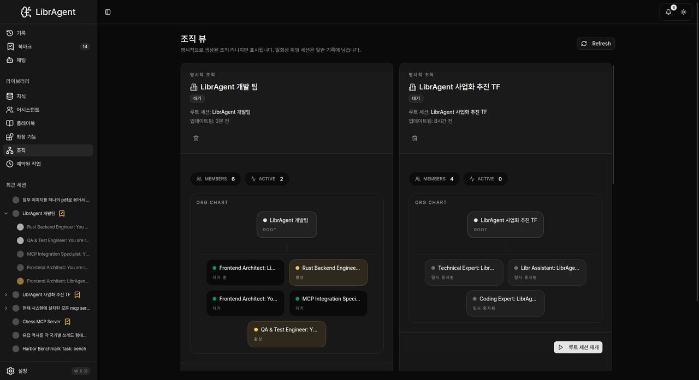

# 서브 에이전트 · 오케스트레이션

> 한 대화(세션)가 다른 대화를 **자식(하위 에이전트)** 으로 띄워 일을 나누는 기능입니다.  
> 병렬·파이프라인·팀 같은 패턴은 번들 **오케스트레이션 스킬**로 고릅니다.

---

## 서브 에이전트란?

|                   | 설명                                                                                                                       |
| ----------------- | -------------------------------------------------------------------------------------------------------------------------- |
| **무엇인가**      | 부모 세션이 만든 **자식 세션**. 부모–자식 관계가 히스토리에 남습니다.                                                      |
| **무엇이 아닌가** | 부모를 그대로 복제한 클론이 **아닙니다**. 기본은 **별도 작업 폴더**이며, 로컬 스킬·폴더 규칙도 자동으로 복사되지 않습니다. |
| **누가 쓰나**     | 보통 `@skill:delegate` 같은 스킬을 붙이면 에이전트가 위임·진행·결과 합치기를 관리합니다.                                   |

부모는 가능하면 **쉬는 중인 같은 역할의 자식**을 다시 쓰고, 필요할 때만 새 자식을 만듭니다. 흐름은 **맡기기 → 진행 확인 → 추가 지시 → 결과 합치기**입니다.  
형제 자식끼리는 직접 대화하지 않고, 부모가 중계합니다.

위임할 때 **작업 난이도**(쉬움 / 보통 / 높음)를 고를 수 있습니다. **Settings → AI & Models → Sub-Agent Model Routing**에서 난이도별 모델을 지정할 수 있고, 비어 있으면 부모·기본 모델을 따릅니다. 가능한 한 낮은 난이도를 고르세요.

### UI에서 보는 곳

| 화면               | 내용                                                                                |
| ------------------ | ----------------------------------------------------------------------------------- |
| **Chat / History** | 세션 카드에 하위 에이전트 개수. 삭제 시 **모두 삭제** vs **이것만 삭제(하위 유지)** |
| 사이드바 **Org**   | **명시적으로 만든 팀**만. 일회성 위임은 여기 안 나옵니다                            |



**Org 내보내기 · 가져오기**: Org 화면에서 팀을 `.libragent-org` 번들 파일로 내보내 다른 PC로 옮기거나 백업할 수 있습니다. 각 Org 카드의 **Export Org**로 저장할 폴더를 고르고, 화면 상단의 **Import Org**로 번들 파일을 선택합니다. 가져오기는 기존 항목과 **병합**하며, API 키 같은 민감 정보는 포함되지 않습니다. 암호화된 번들은 아직 이 화면에서 가져올 수 없으니 암호 없이 내보낸 번들을 사용하세요.

---

## 이 기능의 원칙

여러 에이전트가 함께 일해도, LibrAgent는 몇 가지 원칙을 어디서나 똑같이 지킵니다.

| 원칙                           | 의미                                                                                              |
| ------------------------------ | ------------------------------------------------------------------------------------------------- |
| **내 컴퓨터에서, 내가 정한다** | 일은 내 컴퓨터에서 하고 결과는 파일로 남습니다. 어떤 모델을 쓸지, 누구에게 맡길지는 내가 고릅니다 |
| **가장 작은 구조부터**         | 한 에이전트로 되면 팀을 만들지 않습니다. 필요할 때만 구조를 키웁니다                              |
| **책임은 부모가 집니다**       | 자식은 맡은 일만 합니다. 결과를 받아 쓸지는 부모가 정합니다                                       |
| **말이 아니라 증거**           | "다 했어요"만으로 끝내지 않고 확인합니다                                                          |
| **어디서나 같은 흐름**         | 어떤 패턴이든 **맡기기 → 확인하기 → 합치기 → 검수하기** 순서는 같습니다                           |

---

## 작동 방식 한눈에 보기

```text
              ┌──────────────── 부모 대화 ────────────────┐
              │ ① 일을 나눔  ② 맡김  ③ 진행 확인  ④ 합침  ⑤ 검수 │
              └──────┬─────────────┬─────────────┬──────┘
                     ▼             ▼             ▼
                 자식 대화 A    자식 대화 B    자식 대화 C
         (각자 어시스턴트·작업 폴더가 있음)   ← 자식끼리는 대화하지 않음
```

스킬을 붙이면 에이전트가 아래 순서로 일합니다. 사용자가 직접 할 일은 없습니다.

| 단계      | 에이전트가 하는 일                                               | 알아둘 점                                                                 |
| --------- | ---------------------------------------------------------------- | ------------------------------------------------------------------------- |
| 확인      | 이미 있는 자식 중 **쉬고 있고 역할이 같은 자식**이 있는지 봅니다 | 있으면 새로 만들지 않고 다시 씁니다                                       |
| 맡기기    | 자식에게 할 일을 적어 줍니다                                     | 자식은 부모의 대화를 모릅니다. 필요한 내용을 모두 적어야 합니다           |
| 기다리기  | 끝날 때까지 기다리거나, 기다리는 동안 다른 일을 합니다           | 일이 여러 개면 보통 기다리지 않고 동시에 시킵니다                         |
| 확인하기  | 자식이 일하는 중인지, 끝났는지 봅니다                            | 막힌 자식은 멈출 수 있습니다                                              |
| 추가 지시 | 부족한 부분을 다시 시킵니다                                      | 새 일을 줄 때는 이전 대화를 비울 수 있습니다. 작업 폴더의 파일은 남습니다 |
| 합치기    | 자식들의 결과를 하나로 만듭니다                                  | 마지막에 부모가 결과를 한 번 더 확인합니다                                |

### 결과는 어떻게 돌아오나요?

- 자식이 **마지막으로 쓴 답변**이 결과입니다.
- 자식이 따로 적어 둔 메모는 부모가 **볼 수 없습니다**.
- 자식이 "파일에 저장했어요"라고만 답하면, 작업 폴더가 따로일 때 부모가 그 파일을 읽지 못합니다. 그래서 요청할 때 **"결과를 답변에 직접 써 줘"** 라고 하거나, 작업 폴더를 함께 쓰게 하세요.
- 자식이 "다 했어요"라고 해도 부모는 그대로 믿지 않고 **직접 확인**합니다. 자세한 내용은 [결과를 믿기 전에](#결과를-믿기-전에-검수하기)를 보세요.

### 일의 어려움 고르기

자식에게 일을 줄 때 어려움을 **쉬움 / 보통 / 높음** 중에서 고릅니다. **Settings → AI & Models → Sub-Agent Model Routing**에서 어려움마다 쓸 모델을 정해 두면, 쉬운 일에는 가벼운 모델을, 어려운 일에는 강한 모델을 씁니다. 정하지 않으면 부모와 같은 모델을 씁니다.

### 한꺼번에 얼마나 일하나요?

- 동시에 일하는 대화 수에는 **한도**가 있습니다. 컴퓨터가 느려지지 않게 지키기 위해서입니다.
- 일이 한도보다 많으면 에이전트가 나눠서 시킵니다. 그래서 병렬 작업이 생각보다 느릴 수 있습니다.
- 자식이 또 자식을 끝없이 만들지 못하게 하는 **안전 한도**도 있습니다. 한도를 넘으면 앱이 새 자식을 만들지 않고 알려 줍니다.

---

## 꼭 기억할 격리 규칙

자식은 기본적으로 **자기 작업 폴더**를 씁니다. 부모 폴더의 파일이 자동으로 따라가지 않습니다.

- 같은 폴더의 결과물을 함께 보고·고치려면, 위임할 때 **「지금 쓰는 작업 폴더를 그대로 쓰라」**고 말하세요.
- 폴더 안 규칙 파일·프로젝트 전용 스킬은 **자식이 쓰는 폴더** 기준으로 읽힙니다.
- **이 어시스턴트**에만 둔 스킬은 자식에 고른 어시스턴트를 따릅니다.
- **내 계정 전체** 스킬은 부모·자식 모두 쓸 수 있습니다.
- 다른 경로를 쓰려면 세션의 **작업 폴더 재정의**로 지정합니다.
- 자식에게 **대화만 초기화**하라고 하면 이전 대화·계획은 비우지만 폴더 파일은 남습니다. 브라우저 탭 상태까지 유지하려면 초기화하지 말고 이어서 지시하세요.

부모가 임시로만 가진 파일이나 규칙을 자식이 “당연히” 안다면 위임이 실패하기 쉽습니다. 넘길 때 **목표·범위·산출물 형식·필수 경로**를 적거나, **같은 작업 폴더를 재사용**하라고 명시하세요.

세부 운영은 `@skill:delegate` 안내를 따르면 됩니다.

---

## 언제 어떤 스킬을 쓰나

입력에 `@skill:이름`을 붙이거나, 에이전트에게 패턴 이름을 말해 주세요.

### 1) 한 번 위임 · 기본

| 스킬           | 이럴 때                                                    |
| -------------- | ---------------------------------------------------------- |
| **`delegate`** | 자식에게 맡기고 지켜보며 결과를 받는 **기본기**            |
| **`recruit`**  | 새 **전문 어시스턴트**를 만들고 싶을 때 (위임 자체는 아님) |
| **`boost`**    | **이미 있는** 어시스턴트 도구를 정리·보강할 때             |

```
@skill:delegate
이 리포의 auth 모듈만 읽고 취약점 후보를 Markdown으로 요약해줘.
```

### 2) 작업 나누기 (일회성 자식)

| 스킬                       | 패턴        | 한 줄                                   |
| -------------------------- | ----------- | --------------------------------------- |
| **`divide-conquer`**       | 병렬 분할   | 겹치지 않는 조각을 나눠 합침            |
| **`hub-spoke`**            | 허브–스포크 | 중앙이 워커만 지휘·병합                 |
| **`pipeline`**             | 순차 조립   | A 결과 → B 입력 → C …                   |
| **`consensus-delegation`** | 다관점 합의 | 같은 질문을 여러 관점으로 → 부모가 조율 |
| **`gatekeeper`**           | 품질 게이트 | 작성 ↔ 리뷰 루프                       |
| **`pair-programming`**     | 페어        | 두 역할이 **같은 작업 폴더**에서 턴제   |

```
@skill:divide-conquer
프론트·백엔드·문서 점검 리포트를 병렬로 나눠 작성한 뒤 하나로 합쳐줘.
```

```
@skill:consensus-delegation
이 PR의 보안·성능·유지보수 관점을 각각 검토하고 의견을 조율해줘.
```

### 3) 지속 팀 · Org

일회성 위임과 다릅니다. **팀 구성**과 **Org 화면**이 필요할 때입니다.

| 스킬                  | 역할                                                   |
| --------------------- | ------------------------------------------------------ |
| **`teamwork`**        | 태스크포스 설계·역할 준비. **먼저** 사용               |
| **`org`**             | Org에 보이는 멤버 세션 만들기. 재개는 **Org 루트**에서 |
| **`org-restructure`** | 이미 있는 Org의 역할·규칙을 고칠 때                    |

흐름: `teamwork`로 준비 → `org`로 팀 만들기 → 사이드바 **Org**에서 이어하기 → 구조 변경은 `org-restructure`.

- **Org** ≠ 예약 작업(`schedule`) ≠ 세션 안 리마인더(`loop`) ≠ 완료 후 깨우기(`call-me-back`)
- 일반 위임만으로는 **Org** 목록에 안 뜹니다

```
@skill:teamwork
리서치·구현·리뷰 3역할 태스크포스를 만들고 hub-spoke로 조율해줘.
```

---

## 패턴 자세히 보기

각 패턴은 번들 스킬이 따르는 순서를 쉽게 풀어 쓴 것입니다. 복사해 쓸 수 있는 예시는 [오케스트레이션 실전 예시](orchestration-examples.md)에 더 있습니다.

### `delegate` — 한 명에게 맡기기

**이럴 때**: 범위가 분명한 일을 다른 에이전트에게 맡기고 결과만 받고 싶을 때. 전문 어시스턴트가 필요한 일에도 좋습니다.

**진행 순서**

1. 맡길 만한 일인지 판단합니다.
2. 쉬고 있는 같은 역할의 자식이 있으면 다시 쓰고, 없으면 새로 만듭니다.
3. 자식이 **어느 폴더에서** 일할지 정합니다. 기본은 자식 전용 폴더입니다. 같은 파일을 봐야 하면 "지금 폴더를 함께 쓰기"를 선택합니다.
4. 목표, 범위, 결과 형식, 필요한 파일 위치를 **빠짐없이** 적어 줍니다.
5. 진행을 확인하고, 필요하면 추가로 시킵니다. 마지막에 결과를 합칩니다.

**요청 예시**

```text
@skill:delegate
지금 폴더의 proposal.md를 투자자 입장에서 읽고 검토해줘.
- 이 폴더를 함께 쓰고, 파일은 고치지 마
- 답변에 "좋은 점 3개 / 부족한 점 3개 / 꼭 물어볼 질문 5개"로 정리해줘
```

### `divide-conquer` — 나눠서 동시에 하기

**이럴 때**: 서로 상관없는 일이 여러 개 있을 때. 예: 문서 12개 번역, 폴더별 점검.

**진행 순서**: 나누기 → 배정하기 → 시작하기 → 진행 보기 → 합치기 → 확인하기

- 조각끼리 **겹치면 안 됩니다**. 두 자식이 같은 파일을 고치면 서로 덮어씁니다.
- 폴더를 함께 쓸 때는 자식마다 **다른 파일 이름**을 쓰게 하세요.
- 합친 뒤에는 전체를 한 번 확인하고, 문제가 있는 조각만 다시 시킵니다.
- 앞 조각의 결과가 뒤 조각에 필요하면 이 패턴이 아닙니다. `pipeline`을 쓰세요.

```text
@skill:divide-conquer
docs 폴더의 한국어 가이드 12개를 영어로 번역해줘.
4개씩 3묶음으로 나눠 동시에 진행하고, 용어는 glossary.md를 따라줘.
끝나면 깨진 링크가 없는지 확인해줘.
```

### `hub-spoke` — 대표 한 명이 전문가들을 지휘하기

**이럴 때**: 조사, 분석, 초안처럼 서로 다른 일을 한 명이 모아서 정리해야 할 때.

**진행 방식**: 대표(허브)가 계획을 세우고 일을 나눕니다. 일하는 사람(스포크)은 **대표에게만** 보고합니다. 스포크끼리는 직접 말하지 않습니다. A의 결과가 B에게 필요하면 대표가 요약해서 B에게 전달합니다.

- 대표에게는 긴 대화 기록 대신 **요약과 파일 목록**만 보내게 하세요. 기록이 너무 길면 대표가 일을 못 합니다.

```text
@skill:hub-spoke
새 결제 서비스를 도입할지 검토해줘.
너는 대표를 맡아줘. 스포크는 ① 가격 조사 ② 사용 방법과 도입 난이도 ③ 법규와 보안 확인이야.
각 스포크에게 1페이지 요약을 받아서, 비교표와 추천안을 만들어줘.
```

### `pipeline` — 단계별로 이어서 하기

**이럴 때**: 앞 단계의 결과가 다음 단계의 재료가 될 때. 예: 조사 → 초안 → 검토 → 마무리.

- 모든 단계가 **같은 폴더**를 씁니다.
- 다음 단계에는 대화 전체가 아니라 **요약과 파일 위치**만 전달합니다.
- 한 단계가 실패하면 그 단계만 다시 합니다.
- 단계끼리 서로 상관없으면 `divide-conquer`가 더 빠릅니다.

```text
@skill:pipeline
"로컬 에이전트로 주간 보고서 만들기"라는 블로그 글을 써줘.
1단계 자료 조사(출처 5개 이상) → 2단계 초안 → 3단계 사실과 말투 검토 → 4단계 최종본.
각 단계의 결과는 drafts 폴더에 저장해줘.
```

### `consensus-delegation` — 같은 질문을 여러 관점으로 보기

**이럴 때**: 하나의 결정을 여러 관점에서 따져 보고 싶을 때. 예: 비용 관점, 위험 관점, 사용 편의 관점.

**진행 방식**: 2~4명의 자식이 **같은 질문을 같은 양식**으로 각자 따로 검토합니다. 자식끼리는 서로의 답을 모릅니다. 부모가 답을 비교하고, **의견이 다른 부분만** 다시 물어 정리합니다. 투표로 정하지 않습니다. 부모가 근거를 보고 판단합니다.

각 자식은 같은 양식으로 답합니다.

```text
결론: 찬성 | 조건부 찬성 | 반대 | 판단 불가
확신 정도: 높음 | 보통 | 낮음
발견한 점: - [내용]: [근거]
위험: - [내용]: [왜 중요한가]
```

팁: 관점마다 새 어시스턴트를 만들지 마세요. 요청에 "당신은 비용 검토자입니다"처럼 **역할을 적어 주면** 충분합니다.

### `gatekeeper` — 만들기와 검수를 반복하기

**이럴 때**: 결과물이 정해진 기준을 꼭 통과해야 할 때.

**진행 방식**: 작성자가 결과물을 냅니다. 검수자가 기준에 맞는지 보고 **통과** 또는 **반려**를 정합니다. 반려하면 고칠 점이 작성자에게 전달되고, 작성자가 고쳐서 다시 냅니다. 사소한 차이로 계속 반복하지 않도록 **최대 3번**까지만 다시 합니다.

```text
@skill:gatekeeper
작성자가 이번 달 공지문 초안을 쓰게 해줘.
검수자는 ① 사실 오류 없음 ② 독자에게 중요한 내용이 먼저 ③ 항목마다 두 문장 이하, 이 세 가지를 확인해줘.
3번 안에 통과하지 못하면 남은 문제를 정리해서 알려줘.
```

### `pair-programming` — 둘이 번갈아 작업하기

**이럴 때**: 두 에이전트가 같은 파일을 번갈아 고치며 서로 확인하게 하고 싶을 때. 코드뿐 아니라 긴 문서에도 쓸 수 있습니다.

**진행 방식**: 두 자식이 **같은 폴더**에서 일합니다. 한 명(운전자)은 만들고 무엇을 바꿨는지 적습니다. 다른 한 명(항법사)은 바뀐 내용을 읽고 문제를 짚어 줍니다. 부모가 차례를 넘겨 주며, 다음 단계로 갈 때 역할을 **서로 바꿉니다**.

```text
@skill:pair-programming
user-guide.md의 설치 설명을 같이 다듬어줘.
한 명은 문장을 고치고, 다른 한 명은 바뀐 부분이 틀리거나 어색한지 읽어줘.
절반쯤 끝나면 역할을 바꿔줘.
```

---

## 결과를 믿기 전에 검수하기

중요한 일은 `delegate` 뒤에 **`delegation-eval-loop`** 를 함께 붙이세요. **자식은 만들고, 부모가 합격을 정합니다.** 자식이 "다 했어요"라고 말해도 그것만으로는 합격이 아닙니다.

**진행 순서**

1. **합격 기준을 먼저 적습니다.** 목표, 건드려도 되는 곳과 안 되는 곳, 체크리스트(`- [ ] 오타 없음`), 결과를 어디에 쓸지를 정합니다.
2. **네 가지를 순서대로 확인합니다.** 앞 단계에서 실패하면 바로 돌려보냅니다.

   | 순서 | 확인하는 것      | 쉬운 설명                                                |
   | ---- | ---------------- | -------------------------------------------------------- |
   | 1    | 정해진 검사      | 부모가 직접 같은 검사를 돌려 봅니다                      |
   | 2    | 범위             | 건드리면 안 되는 곳을 건드렸는지 봅니다                  |
   | 3    | 진짜로 했는지    | 말뿐인 "완료", 중간에 멈춘 일, 증거 없는 일을 걸러냅니다 |
   | 4    | 내 의도와 맞는지 | 1~3을 통과한 뒤 부모가 마지막으로 판단합니다             |

3. **돌려보낼 때는 구체적으로 말합니다.** "다시 해"가 아니라 실패한 내용을 그대로 전달합니다.
4. **횟수를 제한합니다.** 3~5번 해도 안 되면 에이전트가 이유를 정리해 사용자에게 알립니다.

```text
@skill:delegate @skill:delegation-eval-loop
고객 안내문의 날짜 표기를 모두 "2026년 3월 5일" 형식으로 통일해줘.
- 고쳐도 되는 곳: notice 폴더 (다른 곳은 고치지 마)
- 합격 기준: - [ ] 모든 날짜가 같은 형식  - [ ] 날짜가 아닌 숫자는 그대로
- 바꾼 파일 목록과 바꾸기 전후 예시 3개를 답변에 써줘
```

---

## 비슷해 보이지만 다른 기능

아래 기능은 위임이나 Org가 **아닙니다**. 필요에 맞게 고르세요.

| 필요한 것                                                | 스킬               | 설명                                                                  |
| -------------------------------------------------------- | ------------------ | --------------------------------------------------------------------- |
| "5분 뒤에 알려줘", "매일 아침 확인해줘" (이 대화 안에서) | `loop`             | 정해진 시각에 이 대화로 돌아옵니다                                    |
| "빌드가 끝나면 알려줘", 웹훅, 티켓 상태                  | `call-me-back`     | 시간이 아니라 **끝났다는 신호**를 기다립니다. [안내](call-me-back.md) |
| 앱을 닫아도 정해진 일정대로 실행                         | `schedule`         | 대화와 상관없이 앱 전체에서 돕니다. [예약 작업](scheduled-tasks.md)   |
| 오래 가는 팀                                             | `teamwork` → `org` | **Org** 화면에 보이고, 팀의 대표 대화에서 이어서 합니다               |

---

## 오래 가는 팀(Org) 운영 순서

1. **`teamwork`** — 정말 여러 갈래의 일인지 먼저 따집니다. 한 에이전트로 되면 팀을 만들지 않습니다. 목표, 역할, 일하는 방식을 정하고 팀 규칙 파일(`MISSION.md`, `ROLES.md` 등)을 앱 전용 폴더에 준비합니다. 일하는 방식은 **순서대로(Sequential)**, **대표 중심(허브-스포크)**, **공유 게시판에서 자유롭게(스웜)** 중 하나를 고릅니다.
2. **`org`** — 대표 대화에서 Org를 **한 번** 만들고, 팀원을 Org 소속으로 만듭니다. 나중에 이어서 할 때는 **Org의 대표 대화**에서 시작합니다. 팀원 한 명의 대화를 다시 여는 것은 Org를 다시 여는 것이 아닙니다.
3. **`org-restructure`** — 팀을 없애지 않고 역할을 더하거나 빼고, 합치고, 규칙을 고칩니다.
4. **`postmortem-improve`** — 일이 끝났거나 같은 실패가 반복될 때 배운 점을 정리하고, 팀 개선으로 이어 줍니다.

Org는 [내보내기·가져오기](#ui에서-보는-곳)로 다른 컴퓨터로 옮길 수 있습니다.

---

## 빠른 선택 표

| 하고 싶은 일                    | 추천                               |
| ------------------------------- | ---------------------------------- |
| 한 자식에게 맡기고 결과만 받기  | `@skill:delegate`                  |
| 큰 일을 독립 조각으로 병렬 처리 | `@skill:divide-conquer`            |
| 중앙이 여러 워커를 배분·통합    | `@skill:hub-spoke`                 |
| 단계가 순서대로 이어짐          | `@skill:pipeline`                  |
| 같은 안건을 여러 관점으로       | `@skill:consensus-delegation`      |
| 작성 ↔ 엄격 리뷰 루프          | `@skill:gatekeeper`                |
| 두 에이전트가 코드 페어         | `@skill:pair-programming`          |
| 오래 가는 팀 + Org 화면         | `@skill:teamwork` → `@skill:org`   |
| 전문 어시스턴트 새로 뽑기       | `@skill:recruit` (이후 `delegate`) |
| 기존 어시스턴트 도구 다이어트   | `@skill:boost`                     |

스킬이 누구에게 적용되는지는 [스킬 가이드](skills.md)를 보세요.

---

## 사용 팁

1. **가장 작은 구조**부터 — 한 에이전트로 되면 팀을 만들지 마세요.
2. **넘기는 내용을 자급자족**으로 — 자식이 부모 대화를 추측하지 않게.
3. **병렬일 때는 부모가 다른 일도 할 수 있게** — 스킬이 안내하는 비동기 위임을 따릅니다.
4. **자식 결과를 확인**한 뒤 최종 답으로 쓰세요.
5. **세션 삭제** 시 하위까지 지울지 History에서 고르세요.

---

## 관련 문서

- [오케스트레이션 실전 예시](orchestration-examples.md)
- [스킬](skills.md)
- [에이전트 첫 대화](../getting-started/first-agent.md)
- [문제 해결](troubleshooting.md)
